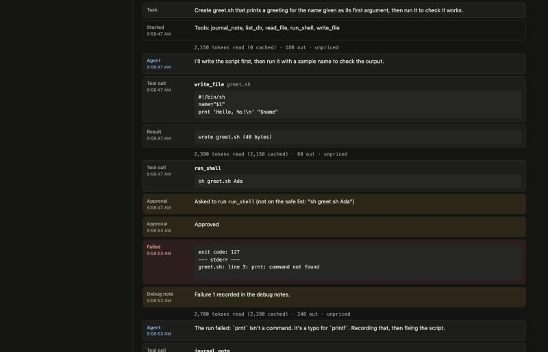
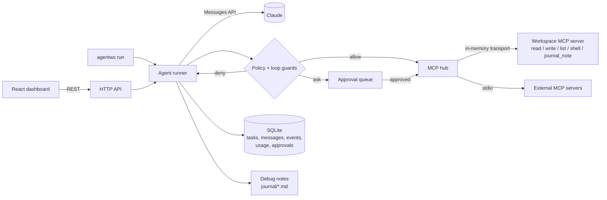

# MCP Agent Workspace

[](https://github.com/kuini-1/mcp-agent-workspace/actions/workflows/ci.yml)

A self-hosted coding agent that works through tasks in a sandboxed folder, keeps state across restarts, asks before risky actions, and writes a debug log whenever something fails.

It is built in Go on the [Model Context Protocol](https://modelcontextprotocol.io): every tool the agent uses, including its own file and shell tools, is served over MCP, so you can plug in any MCP server (GitHub, fetch, databases) next to them. A React dashboard shows each task's timeline, pending approvals, debug notes, and token cost.



**Live demo:** not deployed yet. Run it locally in demo mode (below); it needs no API key.

## What it does

- **Persistent tasks.** Tasks move through `todo → in_progress → awaiting_approval → blocked / completed`. The conversation, events, costs and approvals live in SQLite, so a task survives a restart and can be resumed with a note.
- **Debug notes on failure.** The first failed tool call creates `data/journal/<task>.md`. Failures are logged automatically with their input and error. The agent adds `tried` / `failed` / `worked` notes through a `journal_note` tool, and is reminded to after every failure. When the task ends, the file gets a **Resolved** or **Blocked** section.
- **Approval guardrails.** A policy sorts each call into *allow*, *ask* or *deny*. Read-only commands run, risky ones wait for a human in the dashboard or terminal, and dangerous ones (`sudo`, `rm -rf /`, `curl … | sh`, force-push) are refused outright in every mode. File tools can't leave the workspace, symlinks included.
- **Loop prevention.** Four independent stops: a model-call cap, a dollar budget, a guard on repeated identical tool calls, and a guard on consecutive rounds where every tool fails.
- **Context compaction.** When a request reads more than the threshold (150k tokens by default), the model writes a structured summary and the task continues from that summary alone.
- **Cost tracking.** Every model call is stored with input, output, cache-read and cache-write tokens and its price. The price is based on the model that actually answered, which matters when a refusal fallback kicks in.

## Quick start

**Demo, no API key.** Every task replays a fixed conversation: the agent writes a script with a typo, the run fails, it records why, fixes it and verifies. It calls no API and costs nothing.

```bash
make demo            # builds the dashboard and the binary, then serves on http://127.0.0.1:8080
```

**Real runs.**

```bash
export ANTHROPIC_API_KEY=...
make build
./bin/agentws serve                                  # dashboard + API
./bin/agentws run --workdir ./my-project "add a --verbose flag to main.go and test it"
```

**Docker.** The server listens on all interfaces inside the container, so set a token:

```bash
docker build -t agentws .
docker run --rm -p 8080:8080 \
  -e ANTHROPIC_API_KEY -e AGENTWS_TOKEN=change-me \
  -v "$PWD/data:/data" -v "$PWD/my-project:/workspace" agentws
```

## How it works



One iteration of the loop:

1. Rebuild the request from stored messages and send it with adaptive thinking.
2. Record usage and cost. Stop if the budget or the call cap is reached.
3. For each tool call: check the loop guard, then the policy. Wait for approval if needed, then call the tool through the MCP hub.
4. Log failures to the debug notes. Append all results as one user message, plus a reminder to record what failed.
5. Stop on `finish_task` or `mark_blocked`, otherwise go back to step 1. Compact first if the last request was over the threshold.

### Design decisions

**The built-in tools go through MCP too.** The workspace tools run as an MCP server over an in-memory transport, so built-in and external tools share one code path: listing, annotations, calls and errors. The same server is exposed over stdio with `agentws mcp`, so Claude Desktop or Claude Code can use the sandboxed tools directly:

```json
{ "mcpServers": { "workspace": { "command": "agentws", "args": ["mcp", "-root", "/path/to/project"] } } }
```

**History is append-only and rebuilt byte for byte.** Assistant turns are stored as raw API responses and user turns as plain blocks. The system prompt and the tool list (sorted) are fixed for the life of a task. Reminders are appended after tool results and never removed. This keeps the prompt cache warm. It also matters for correctness: current Claude models bind thinking blocks to the conversation that produced them, and reject a replayed block whose earlier history was edited. A test (`TestEveryRequestExtendsThePreviousOne`) checks that every request is a strict extension of the previous one.

**Compaction replaces the whole history.** A common pattern keeps the last few turns verbatim and summarizes the rest. That breaks under thinking-block binding, because the kept turns' thinking was produced with the full history present. Here the model writes a summary covering goal, files, commands, failures, what works and the next step. The next request starts from that summary alone, and the old conversation stays in the database as an earlier "epoch" for the timeline.

**Policy runs on the client.** MCP tool annotations (`readOnlyHint`, `destructiveHint`) feed the decision, but the final call is made in the runner, before anything reaches a server. Per-server overrides live in `agentws.json`. Shell commands are split on `&&`, `||`, `;` and `|`, and every segment must be on the safe list. Redirects and command substitution always ask.

**Local file memory vs. vector memory.** The agent's memory is the conversation, the compaction summary and the Markdown debug notes, not a vector store. For one task in one workspace, what matters is exact: file paths, error text, commands. Plain files hold that losslessly, and the agent can re-read the code itself, which is the real source of truth. A vector store would help across tasks ("have we seen this error before?") and is a natural next step. It adds an embedding pipeline and fuzzy recall that can surface stale notes with confidence.

## Approval modes

| Mode | Read-only tools | File writes (in workspace) | Safe shell (`ls`, `go test`, `git diff`…) | Other shell / external tools | Deny list |
|---|---|---|---|---|---|
| `safe` (default) | run | run | run | **ask** | refused |
| `auto` | run | run | run | run | refused |
| `readonly` | run | refused | run | refused | refused |

## API

| Method | Path | Purpose |
|---|---|---|
| `POST` | `/api/tasks` | Create and start a task: `{"prompt": "...", "budget_usd": 1.5, "workspace": "optional-folder"}` |
| `GET` | `/api/tasks` | List tasks |
| `GET` | `/api/tasks/{id}` | Task, approvals, per-call usage and debug notes |
| `GET` | `/api/tasks/{id}/events?after=N` | Timeline events after id N |
| `POST` | `/api/tasks/{id}/resume` | Resume a blocked task: `{"note": "use go test instead", "budget_usd": 3}` |
| `POST` | `/api/tasks/{id}/cancel` | Stop a running task |
| `POST` | `/api/approvals/{id}` | Decide: `{"approve": false, "note": "don't install packages"}` |
| `GET` | `/api/stats` | Totals across tasks |

When `AGENTWS_TOKEN` is set, every `/api` call needs `Authorization: Bearer <token>`.

Example:

```bash
curl -s -X POST localhost:8080/api/tasks -H 'Content-Type: application/json' \
  -d '{"prompt": "Create greet.sh that prints Hello, <name>!", "budget_usd": 0.5}'
```

```json
{"id":"t_2dde121c5e","title":"Create greet.sh that prints Hello, <name>!","status":"todo",
 "workdir":"/workspace/t_2dde121c5e","model":"claude-opus-5-5","budget_usd":0.5,"cost_usd":0, "...": "..."}
```

## Configuration

Flags override environment variables (see `.env.example`). MCP servers and per-server policy go in `agentws.json` (see `agentws.example.json`), in the same `mcpServers` shape Claude Desktop uses. External tools appear to the model as `<server>__<tool>`.

| Setting | Flag / env | Default |
|---|---|---|
| Model | `--model` / `AGENTWS_MODEL` | `claude-opus-5-5` |
| Effort | `--effort` / `AGENTWS_EFFORT` | `high` |
| Approval mode | `--approval` / `AGENTWS_APPROVAL` | `safe` |
| Budget per task | `--budget` / `AGENTWS_BUDGET` | `$2.00` |
| Compaction threshold | `--compact-at` / `AGENTWS_COMPACT_AT` | 150,000 tokens |
| Model calls per task | `--max-iterations` | 60 |
| Refusal fallbacks | `--fallbacks` | on |

## Model provider

All model calls go to the Anthropic Messages API through the official Go SDK (`anthropic-sdk-go`), using adaptive thinking and summarized thinking in the timeline. Server-side refusal fallbacks are on, so a declined request can be served by a fallback model in the same call. Usage is billed to your Anthropic account under Anthropic's commercial terms. The price table in `internal/agent/pricing.go` reflects list prices as of November 2026; update it if prices change.

## Tests

```bash
make test
```

The agent tests drive the real loop, the real MCP tools and a real SQLite database. Only the model is swapped for a scripted client that returns canned API responses. They cover: failure notes and completion, append-only requests, the loop guard, denied approvals, policy refusals, compaction, the budget stop, refusal and resume, and the request shape. A server test runs the demo task end to end over HTTP and approves its commands through the API.

## Limitations

- The shell runs on the host as your user, limited to the workspace folder as its working directory. The policy is a guardrail, not a sandbox. Use Docker for untrusted tasks.
- One user, no accounts. The optional bearer token is the only access control.
- The demo replays fixed responses; it does not react to what you approve or deny.
- Token counts estimate cost from list prices. Your invoice is the source of truth.

## Lessons learned

- **Editing history breaks more than the cache.** Injecting a status line into an earlier message, or trimming old tool results, looks harmless. With thinking blocks bound to their conversation, it causes hard 400 errors. Keeping the history strictly append-only, with a test that enforces it, rules that out.
- **A non-zero exit code is a failure, even when the tool "worked".** If `exit 1` counted as a successful call, failed builds would never reach the guards or the debug notes. Marking it as a tool error is what makes the notes useful.
- **An iteration cap alone doesn't stop loops.** The common failure is the same call with the same arguments, retried in slightly different words. Hashing normalized arguments catches it within three tries instead of sixty.
- **Scripted model responses make agent code testable.** Swapping only the model for canned responses, and keeping real tools, a real database and real MCP transport, gives fast, deterministic tests of the parts that break most often.
